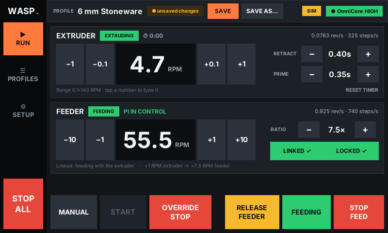
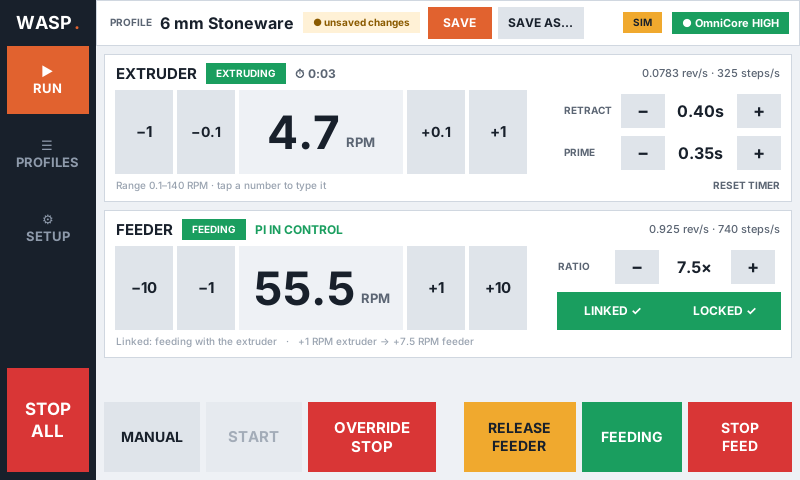
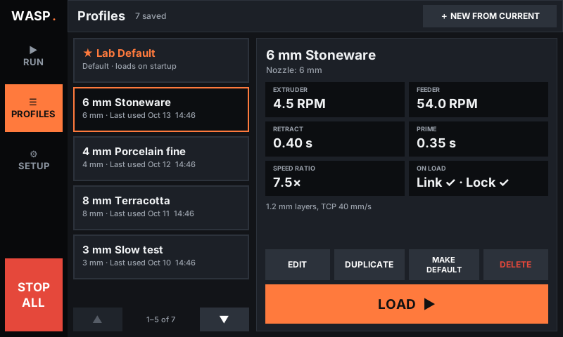
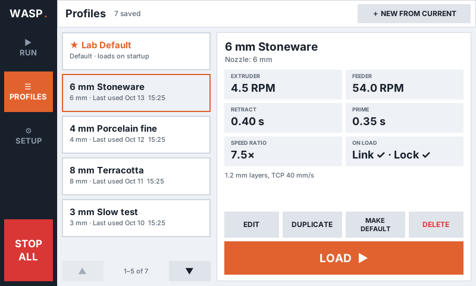

# GKL_Wasp

Touchscreen controller for a **WASP clay extruder + continuous feeder** on a
Raspberry Pi 5. The extruder is driven by the **ABB GoFa / OmniCore** on/off
signal. CraftLab, University of Houston.

| Dark | Light |
|---|---|
|  |  |
|  |  |

## What it does

- **Profiles:** once you've tuned feed and speed for a nozzle, save the
  settings as a named profile. The app opens on the profile list, with the
  ★ default at the top. Each profile stores:
  - extruder RPM and feeder RPM
  - feed ratio
  - retract and prime times
  - whether Link and Ratio Lock are on
  - nozzle and notes
- **Real RPM:** both motors show output-shaft RPM. The extruder now goes down
  to 0.1 RPM (the old minimum was 6 RPM). Nudge buttons step by ±0.1/±1 on the
  extruder and ±1/±10 on the feeder; hold one down to repeat. Tap any number
  to type an exact value.
- **STOP ALL:** on the side rail on every page.
  - Stops the extruder. If OmniCore is HIGH, it holds an override stop until
    the robot's signal drops.
  - Stops and unlinks the feeder. The Pi keeps the relay so the front panel
    can't restart the feeder.
- **Dark / light theme:** switch on the Setup page. The choice is remembered.
- **Feeder takeover:** TAKE CONTROL (green) switches the relay from the
  feeder's front panel to the Pi. RELEASE FEEDER (amber) hands control back.
  A message confirms each switch. LINK makes the feeder run whenever the
  extruder runs.
  RATIO LOCK makes the feeder follow extruder speed changes (feeder change =
  extruder change × ratio).

## Install on the Pi (Raspberry Pi OS Bookworm)

The Pi needs Wi-Fi. `python3-tk` and `python3-lgpio` come with Raspberry Pi OS.

```bash
git clone https://github.com/C-A-Battaglia/GKL_Wasp.git ~/GKL_Wasp
bash ~/GKL_Wasp/tools/install_desktop.sh
```

This puts two icons on the desktop and in the app menu:

- **WASP Control** opens the app fullscreen. Esc or F11 toggles fullscreen.
- **Update WASP Control** downloads the latest version from GitHub, shows
  what changed, and refreshes the icons. Your profiles are not touched; they
  live in `~/.wasp_control/`. If the app is open, quit it and reopen it to
  use the new version.

**Update notice:** the app checks GitHub a few seconds after it opens, and
every 6 hours while it stays open. If a newer version is available, a green
dot appears on SETUP and a message pops up once. The Setup page says what's
available. The check never installs anything; the code only changes when you
tap the Update icon. Start the app with `--no-update-check` to turn the check
off.

Add `--autostart` to the install command if the app should also start
automatically when the Pi logs in.

You can also run the app from a terminal: `python3 ~/GKL_Wasp/wasp_control.py --fullscreen`.

## Testing without hardware

```bash
python3 wasp_control.py --sim
```

`--sim` replaces GPIO with a simulator. The Setup page then has a button that
toggles a fake OmniCore signal. To run the tests:

```bash
pip install pytest
python3 -m pytest tests                    # GUI test runs when a display is available
xvfb-run python3 tools/screenshots.py      # regenerate docs/screens
```

## Layout

| Path | |
|---|---|
| `wasp_control.py` | entry point |
| `wasp/config.py` | GPIO pins, motor constants, speed limits |
| `wasp/gpio.py` | lgpio wrapper and simulator |
| `wasp/motion.py` | stepper, extruder state machine, feeder, STOP ALL |
| `wasp/profiles.py` | profile and settings storage (JSON, crash-safe writes) |
| `wasp/updates.py` | checks GitHub for a newer version (never installs) |
| `wasp/ui/` | Tkinter GUI: theme, touch widgets, pages |
| `tools/install_desktop.sh` | adds the desktop and menu icons |
| `tools/update.sh` | updater run by the Update icon |
| `assets/` | icon images |
| `legacy/WASP3326.py` | the previous single-file version, kept for reference |
| `mockups/` | design concepts A/B/C |

## Units and limits

`steps/s = RPM ÷ 60 × steps per output rev`

| Motor | Steps per output rev | Range |
|---|---|---|
| Extruder | 4144 (200 × 4 microsteps × 5.18 gearbox) | 0.1–140 RPM |
| Feeder | 800 | 0.5–180 RPM |

The extruder tops out at 140 RPM because lgpio's software PWM maxes out at
10 kHz. The old maximum (factor 3.0, i.e. 180 RPM) would have needed 12.4 kHz.

Old speed factor → RPM: multiply by 60. For example, 0.20 → 12 RPM and
1.50 → 90 RPM.
